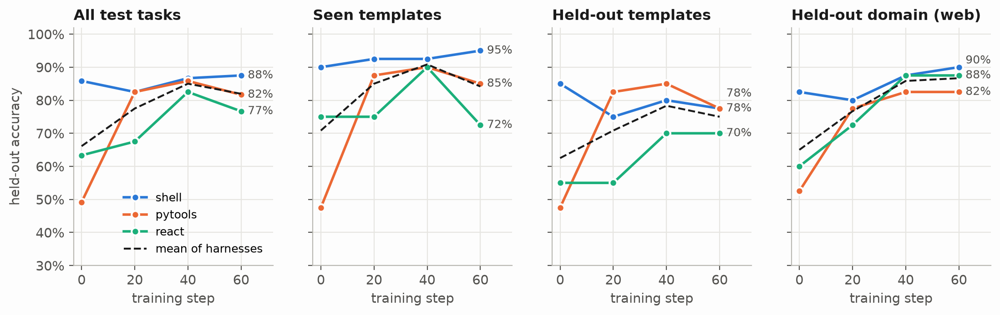
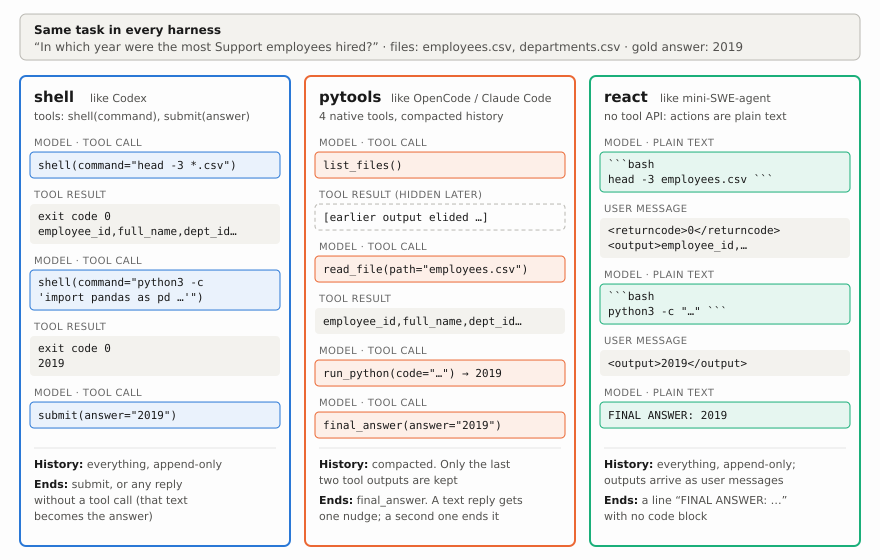
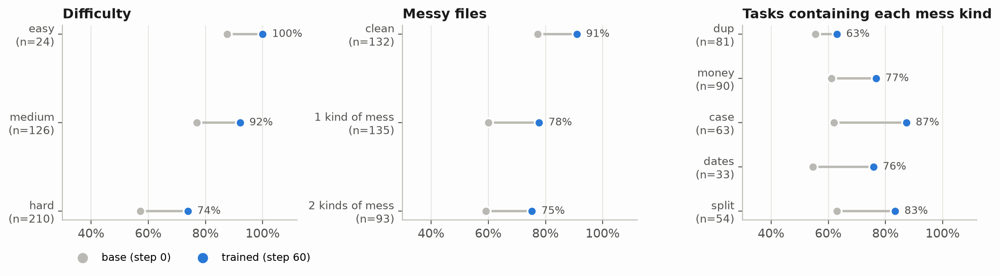
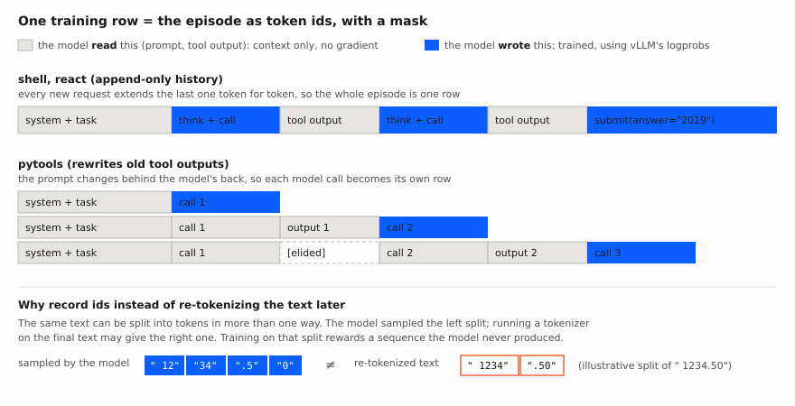

*A mini replication of Hugging Face's [The ultimate guide to multi-harness RL](https://huggingface.co/spaces/FineEnvs/multi-harness-rl), on one consumer GPU.*

The same model can behave very differently depending on the program wrapped around it, called a harness. In their guide, the FineEnvs team at Hugging Face argue that if you want a small open model to work well in Claude Code, Codex, and OpenCode, you should train it inside all of them at once, with reinforcement learning, and without changing a line of the harnesses' code. They trained LFM2.5-2.6B across four real harnesses on data-analysis tasks built from Kaggle notebooks, and its held-out accuracy went from 42% to 54%, averaged over the four.

I wanted to know how much of that I could reproduce on my own machine. I kept the parts that make the method what it is: the same model, a capture proxy that records the exact tokens the model sampled, GRPO with groups of 8, and the same reward (1 for a correct answer plus a small bonus for using fewer tool calls). The rest I scaled down to fit one GPU:

| | Hugging Face | This post |
|---|---|---|
| Model | LFM2.5-2.6B | LFM2.5-2.6B |
| Harnesses | 4 real ones, unmodified: OpenCode, Claude Code, Codex, mini-SWE-agent | 3 small harnesses I wrote to mimic Codex, OpenCode / Claude Code, and mini-SWE-agent |
| Tasks | SmolDataEnvs: 1,000 training tasks from real Kaggle notebooks, 250 held out | synthetic CSV questions about retail, HR, and website data, with deliberately messy files, 120 held out |
| Training | async GRPO in TRL, 1,000 steps | my own synchronous GRPO loop, 60 steps, with a **LoRA** adapter |
| Hardware | two H100s, 32–46 hours per run | one RTX 3090 Ti (24 GB), about 5 hours |

The biggest change is LoRA. With one 24 GB card shared between vLLM and the trainer, there's no room to train all 2.6 billion weights, so I froze the model and trained a small low-rank add-on next to each weight matrix instead: 40M parameters, about 1.5% of the model. So part of what this post tests is whether multi-harness RL still works when you can only afford to train a sliver of the model.

The tasks are a different kind of data analysis too. Mine are generated rather than taken from real notebooks, which means I can make as many as I want and hold out whole question types and a whole data domain, but they're also easier. That means my accuracy numbers aren't comparable with Hugging Face's. What can be compared is whether the same effects show up.

What I found:

- **The main result holds up with LoRA on one GPU.** Training a LoRA adapter for 60 steps, about five hours, took held-out accuracy across the three harnesses from 66% to 82%. Of the 360 paired test attempts, 90 went from wrong to right and 33 went the other way.
- **The model got better at the task, not just at my training questions.** Question types it never trained on went up 13 points, the same as the ones it did. Website data it had never seen went from 65% to 87%.
- **The harness it was worst in improved the most, mostly by learning when to stop.** In the OpenCode-style harness, the untrained model often kept exploring until it ran out of turns, and solved only 49% of tasks. After training it solved 82%. And as in the Hugging Face runs, it used fewer tool calls in every harness.
- **Training only fixes what the reward measures.** The model kept some wrong habits, like writing actions in the wrong format, because they didn't affect whether the answer was right.



If you already know what a harness is and how GRPO works, skip to [C. The experiment](#c-the-experiment) or the [appendix (H)](#h-appendix).

## A. What is harness RL?

### A.1 A language model on its own can't do anything

A language model does one thing: it reads text and writes more text. It can't open a file, run a program, or look anything up. When you watch Claude Code edit a repository or Codex run your tests, the model isn't doing those things itself. An ordinary program is doing them for it.

That program is the **harness**. It sits between the model and the world and runs a loop:


1. **Build the prompt.** The harness writes the text the model will read: the rules ("you are a coding agent…"), the tools it can use, the task, and everything that has happened so far.
2. **Parse the reply.** The reply is just text, so the harness has to find the *action* in it. That might be a structured tool call, a code block, or a final answer.
3. **Run the action.** The harness runs the command (here, in a Docker sandbox) and adds the output to the history.
4. **Decide when to stop.** Maybe the model called a `submit` tool, maybe it wrote a magic line like `FINAL ANSWER:`, or maybe it ran out of turns.

Then it goes back to step 1 until step 4 says stop. One trip around the loop is a **turn**, and the whole thing from task to answer is an **episode**, or in RL terms a **rollout**.

### A.2 Every harness runs the loop differently

Claude Code, Codex, OpenCode, and mini-SWE-agent all run this loop, but they disagree on almost every detail:

- **How actions are written.** Some give the model a tool API, and the model emits structured calls like `shell(command="ls")`. Others have no tool API at all. The model writes a ```` ```bash ```` block as plain text and the harness pulls it out with a regular expression.
- **What the model sees of the past.** Some keep the full history. Others *compact* it, replacing old tool outputs with a stub to save space, so the model has to remember (or re-read) what it already saw.
- **How an episode ends.** A `submit` tool, a `final_answer` tool, a magic string, or just a reply with no tool call.

I used three harnesses, each modelled on a real one:

- **shell** (like Codex) gives the model two tools, `shell(command)` and `submit(answer)`, and keeps the full history. A reply with no tool call ends the episode, and that text becomes the answer.
- **pytools** (like OpenCode or Claude Code) gives it four tools: `list_files`, `read_file`, `run_python`, and `final_answer`. It compacts the history, keeping only the last two tool outputs. If the model replies in plain text it gets one nudge, and a second plain-text reply ends the episode.
- **react** (like mini-SWE-agent) has no tool API. The model writes ```` ```bash ```` blocks as text, the outputs come back as user messages, and the episode ends with a `FINAL ANSWER:` line.

Here's a real test task as it plays out in each one:



The question is *"In which year were the most Support employees hired?"* and the answer is 2019. In every harness the model does the same three things: look at the files, run a bit of pandas, give the answer. But what it has to type to do those things is different each time.

A way to think about it: the model is a skilled typist, and the harness is the keyboard layout. The skill carries over, but someone who's only ever typed on one layout will make a lot of mistakes on another, even though they know how to type.

### A.3 Why the harness matters for training

If you want to fine-tune a model to be a better agent, you have to run it inside *some* harness. Whatever you train in, the model learns two things together:

1. **The task skill:** look at the data, write correct code, check the result.
2. **The harness habits:** this one ends with `submit`, that one wants `FINAL ANSWER:`, this one hides old outputs.

So if you train in one harness and then switch to another, the model brings the wrong habits with it. The Hugging Face guide's answer is simple: train in several harnesses at once, and leave them alone. Don't rewrite them to make training easier. Just record what the model saw and what it wrote, and learn from that. That's what I mean by *harness RL*.

### A.4 How hard are these tasks?

Each task makes fresh CSV files about a small company (retail orders, HR records, or website sessions) and asks one question about them. The questions come from 46 templates. Column names are picked at random from a few variants, so a date column might be `order_date`, `date`, or `OrderDate`, and the agent has to look at the files before it can write any code. The right answer is computed with pandas on clean data, and the grader accepts a number within 0.1% of it.

Real data is messy, so half the medium tasks and 9 in 10 of the hard ones have something wrong with the files:

| Problem | What the agent sees |
|---|---|
| `dup` | exact duplicate rows (the question says to count each one once) |
| `money` | `"$1,234.50"` stored as text instead of a number |
| `case` | `"north"`, `"NORTH "`, and `" North"` for the same label |
| `dates` | `2024-03-05`, `03/05/2024`, and `Mar 5, 2024` mixed in one column |
| `split` | the main table spread over `orders_part1.csv … orders_part4.csv` |

For a 2.6B model these are hard but not hopeless, which is what you want. The untrained model gets 66% of test tasks right across the three harnesses: 88% of easy ones, 77% of medium, and 57% of hard. That leaves plenty of room to improve, and it means the model solves a lot of tasks *sometimes*, which matters for the algorithm below.

## B. How RL works here

**Let the model try a task several times, grade each attempt, and make whatever it did on the better attempts more likely.**

### B.1 The reward

Nobody writes example solutions. The only supervision is a checker that knows the right answer. The reward for one episode is:

$$
r \;=\; \underbrace{\mathbb{1}[\text{correct}]}_{\text{0 or 1}} \cdot \Big(1 \;+\; \underbrace{0.1 \cdot \mathrm{clip}\big(\tfrac{10 - n_{\text{calls}}}{8},\, 0,\, 1\big)}_{\text{between 0 and 0.1}}\Big)
$$

A correct answer is worth 1, plus a small bonus for using fewer tool calls: two calls or fewer gets the full 0.1, ten calls gets nothing. A wrong answer is worth 0 however quick it was, so nothing can be gained by guessing fast. The 0.1 keeps efficiency a tie-breaker. It only ranks attempts that were already right.

### B.2 Group-relative advantages (GRPO)

The algorithm is **GRPO** (Group Relative Policy Optimization). Instead of training a second network to guess how good each attempt *should* be, GRPO runs the same task several times and compares the attempts with each other:


Each attempt's **advantage** is how much better it did than the group average, divided by the group's spread:

$$
A_i = \frac{r_i - \bar r}{\sigma_r + 0.05}
$$

where the $+0.05$ stops near-identical scores from producing huge advantages. Every token the model wrote in an attempt gets that attempt's advantage. A positive advantage makes those tokens more likely, a negative one makes them less likely.

Two things follow from this, and both shaped the experiment:

- **A group where every attempt scores the same teaches nothing.** If all 8 attempts are right (too easy) or all 8 are wrong (too hard), every advantage is zero. The useful tasks are the ones the model solves sometimes. That's why the training mix is 10% easy, 30% medium, and 60% hard: easy tasks mostly give groups where all 8 succeed.
- **Small reward differences still count.** Among correct attempts, the efficiency bonus is often the only thing that separates them, so the model gets nudged toward shorter episodes.

### B.3 Training a black box: the capture proxy

The harnesses here are ordinary agent loops. Each one gets an OpenAI-compatible URL and nothing else. The trick is what sits behind that URL.


The harness sends chat messages to a **capture proxy**. The proxy turns the messages into **token ids** using the model's chat template and sends those ids to vLLM, the inference server. For every call it records three things: the prompt ids, the ids the model sampled, and the probability of each sampled token. The trainer learns only from these records, and it never needs to know which harness produced them.

Why record ids instead of text? A model writes one token at a time, and the same final text can usually be split into tokens in more than one way. If you rebuild the training data from the chat text afterwards, the tokenizer might pick a different split from the one the model actually sampled, and you'd be training on a sequence the model never produced. Recording the ids at sampling time avoids that. The details of how calls get stitched into training rows are in [H.1](#h1-the-capture-proxy-and-how-calls-become-training-rows).

### B.4 The loss

The trainer computes each sampled token's probability under the current weights, $\pi_\theta$, and compares it with the probability vLLM recorded when it sampled the token, $\mu$. In theory they're the same model, but they run on different GPU kernels and disagree slightly. A capped importance weight corrects for that:

$$
\mathcal{L}(\theta) \;=\; -\frac{1}{N}\sum_{t} m_t\, \min\!\Big(\frac{\pi_\theta(y_t)}{\mu(y_t)},\, 2\Big)\, A_t \,\log \pi_\theta(y_t)
$$

- **$A_t$** is the advantage of the attempt that token $t$ belongs to.
- **$m_t \in \{0, 1\}$** masks in only the tokens the model wrote. Prompts and tool outputs are context, not training targets.
- **The weight $\min(\pi_\theta/\mu,\ 2)$** stays close to 1 throughout the run (see [H.4](#h4-training-health)).
- **$N$** is the number of model-written tokens in the batch.

The model is trained with **LoRA**: the 2.6 billion original weights are frozen, and a small add-on is learned next to each weight matrix. That's 40M trainable parameters, about 1.5% of the model, which is what lets the trainer share one 24 GB card with vLLM. More in [H.2](#h2-lora-and-the-memory-budget-on-one-24-gb-gpu).

## C. The experiment

**Can one small model get better at a task inside three different harnesses at once, and does that carry over to questions and data it never trained on?**

### C.1 Why three harnesses, and why a held-out split

My first version of this experiment trained in pytools only, and accuracy went from 64% to 100%. That looked great until I checked the test set: 46 of the 50 test questions reused training templates. The model had learned the templates, not the skill.

So this version changes two things. It trains in all three harnesses at once, with the same weights, so the model can't just learn one harness's habits. And it splits the test set three ways, each one further from the training data than the last.

### C.2 Setup

Everything runs on a single 24 GB RTX 3090 Ti, shared between vLLM, which generates the rollouts, and the trainer. They take turns. The model is LFM2.5-2.6B, the same model as in the Hugging Face guide, trained with a rank-32 LoRA.

Each training step draws 12 tasks, 4 per harness, and the model attempts each one 8 times, for 96 rollouts per step. Every harness gets at most 10 turns. The run is 60 steps, about five hours and twenty minutes. Rollouts are sampled at temperature 1.0 and evaluations at 0.7. I evaluated at steps 0, 20, 40, and 60. The single-GPU details are in the [appendix](#h-appendix).

### C.3 Training and test tasks

Training questions come from 28 of the retail and HR templates. The test set has 40 tasks in each of three groups, and every test task is run once in each harness, which gives 360 attempts per checkpoint.

| Test group | What's new | Example |
|---|---|---|
| **Seen** | nothing but the data | *"In which year were the most Support employees hired?"* |
| **New questions** | 7 retail and HR question types never trained on | *"Which month had the largest revenue increase over the previous month?"* |
| **New domain** | website-session data instead of retail or HR (all 11 templates held out) | *"Which plan has the highest average sessions per user, counting users with zero sessions?"* |

### C.4 A harness the model couldn't use

Before training, react scored **0%**, and the reason is worth a look. react has no tools, so the model is supposed to write a ```` ```bash ```` block as plain text. LFM2.5 reasons about this correctly, and then does the other thing anyway:

```text
...The error suggests I should write exactly one ```bash code block as plain text.
Let me first try to read the file with a bash command.</think><|tool_call_start|>[bash(command='head -5 employees.csv')]<|tool_call_end|>
```

It *says* it should write a bash block, then emits its built-in tool-call syntax. I tried adding a worked example to the prompt, and an explicit "you have no tool-calling functions" line. Neither helped (0 out of 30). The habit sits below what prompting can reach.

RL can't fix that from zero, because a group of 8 failures has no signal. So I gave react a fallback: a single `bash(command=...)` call written as text is accepted as an action. Everything else stays the same. There's still no tool schema, outputs still come back as user messages, and the episode still ends with `FINAL ANSWER:`. With the fallback, untrained react scores 63%. I kept track of how often the fallback fires, to see whether training would move the model toward the intended format. It mostly didn't, and I come back to why in [D.4](#d4-what-the-reward-cant-see).

## D. Results

**Training across three harnesses works, the gains carry over to unseen questions and data, and they go where the model started weakest.**

The full result tables are in the [appendix](#h5-held-out-accuracy-by-step-and-harness).

### D.1 Every harness gets better, the weakest one most

Across all three harnesses, held-out accuracy went from 66.1% to 77.5% at step 20 and 85.0% at step 40, then finished at 81.9% (the curves are at the top of the post). But the average hides a lot. Each harness moved very differently:

| Harness | Step 0 | Step 60 | Wrong → right | Right → wrong | $p$ |
|---|---|---|---|---|---|
| shell | 85.8% | 87.5% | 13 | 11 | 0.84 |
| pytools | 49.2% | 81.7% | 47 | 8 | $8\times10^{-8}$ |
| react | 63.3% | 76.7% | 30 | 14 | 0.02 |
| **all** | **66.1%** | **81.9%** | **90** | **33** | $3\times10^{-7}$ |

*(Each test task in each harness is run once at step 0 and once at step 60. The two middle columns count the tasks that flipped, and $p$ asks how likely a split that lopsided would be if training had changed nothing.)*

**pytools gained the most because it started worst.** Before training, about a third of pytools episodes hit the 10-turn limit. The model kept exploring, re-reading files and re-running scripts, and never called `final_answer`. Compaction made this worse: old outputs turn into "[earlier output elided]", so the model re-reads what it already saw. Training fixed the cheap part first. Turn-limit failures dropped from 32% to 4%, and tool calls per episode fell from 8.6 to 5.5.

**shell barely moved, because there was little left to fix.** The untrained model already solved 98% of medium shell tasks and all of the easy ones. Its remaining mistakes were on hard tasks (77% → 81%), and with 120 test tasks a 2-point change is noise.

**The drop from step 40 to step 60 isn't a real regression.** Overall accuracy went from 85.0% to 81.9%, but comparing the two checkpoints task by task gives 28 fixed and 39 broken ($p = 0.22$). Evaluation samples at temperature 0.7, so swings of a few points between checkpoints are expected. The fair reading is that the run levelled off after about 40 steps.

### D.2 It learned the process, not the questions

| Test group (all harnesses) | Step 0 | Step 60 | Change |
|---|---|---|---|
| Seen | 71% | 84% | +13 |
| New questions | 62% | 75% | +13 |
| New domain (website data) | 65% | 87% | **+22** |

This is the result I was most worried about after the first run, and it came out well. Question types the model never trained on improved as much as the ones it did, and the website data it had never seen improved the most.

That suggests training mostly taught *process* rather than answers: look at the columns, clean the messy values, stop exploring, and answer. The website tasks are mostly single-table lookups, which reward exactly that. The new question types are harder multi-step questions, and they still sit 9 points behind the seen ones.

### D.3 Where it helped, and the mistake it kept making



Accuracy went up at every difficulty level: easy 88% → 100%, medium 77% → 92%, hard 57% → 74%. It also went up on clean files and on files with one or two problems. But not every problem got fixed equally:

| Problem | Step 0 | Step 60 |
|---|---|---|
| inconsistent capitalisation (`case`) | 62% | 87% |
| table split across files (`split`) | 63% | 83% |
| mixed date formats (`dates`) | 55% | 76% |
| money stored as text (`money`) | 61% | 77% |
| duplicate rows (`dup`) | 56% | **63%** |

The pattern makes sense once you think about what the model can actually see. `"$1,234.50"` raises an error when you try to sum it. `" NORTH"` shows up right there in a `value_counts()`. The part files are listed in the prompt. Duplicate rows are different. They don't raise an error, they just produce a plausible wrong number, even though the question warns about them. They were the most persistent failure in the run, and a pretty realistic one.

The hardest single question was in the new domain: *"Which plan has the highest average sessions per user, counting users with zero sessions?"* (33% → 50%). It's a denominator trap. Getting it right needs a left join so that users with no sessions are counted, and every shortcut gives a confident wrong answer.

### D.4 What the reward can't see


Some behaviour changed in ways I wanted. Tool calls per episode dropped in every harness: shell from 4.3 to 3.4, react from 4.3 to 3.4, and pytools from 8.6 to 5.5. The efficiency bonus is tiny, but inside a group of 8 it's often the only thing separating two correct attempts, so it adds up.

Two other things didn't go the way you'd hope, and they have the same cause.

**react kept its non-standard action format.** The fallback fired on 85% of react actions before training and 79% after. Writing a proper bash block and writing the built-in tool-call syntax as text earn exactly the same reward, so nothing pushed the model toward the intended one.

**pytools picked up a habit from shell.** Between steps 40 and 60, pytools episodes shifted from ending with the `final_answer` tool (76% → 42%) to ending with a plain-text reply (20% → 53%). In pytools a plain-text reply gets one nudge, and a second one ends the episode with that text as the answer. The grader scores both endings the same, so the reward can't tell them apart. Ending with plain text is exactly what shell does: there, any reply without a tool call ends the episode. So it looks like a shell habit leaking into pytools through the shared weights, in a way the reward never sees.

So a harness only shapes the model through what the reward can see. If you care *how* the model behaves inside a harness, and not just whether it gets the answer right, that has to be part of the reward.

### D.5 How much to trust this

This is a small experiment, so take the numbers with a grain of salt. I ran it once, with one seed. Each harness has 120 test tasks, so differences of less than about 8 points between single checkpoints are within noise. That's why the main claims use paired task-by-task comparisons. react is really "react with a fallback", and without the fallback it scores 0%. My three harnesses are small imitations of the real ones, so they're much simpler than Claude Code or Codex, and this run doesn't test whether the gains carry over to the real thing. The tasks are synthetic: I wrote the CSV generator, and real data is messy in ways I didn't think of. Finally, two infrastructure stalls (at steps 14 and 43) scored a batch of timed-out rollouts as wrong answers, which skewed those two updates. The run recovered from both by the next step ([H.8](#h8-infrastructure-stalls)).

## E. Conclusion

**Harness RL works at hobby scale.** One 3090 Ti, a 2.6B model, LoRA, and five hours took held-out accuracy from 66% to 82%, and the biggest jump was on data the model had never seen. You don't need a cluster to try this.

**Record tokens, not text.** The capture proxy is what makes black-box harnesses trainable. The harnesses don't change at all, and the trainer only ever sees token ids and probabilities. It's about 220 lines.

**Look at each harness, not just the average.** pytools gained 32 points, react 13, and shell 2. In a multi-harness run, the average hides which harness is actually learning, and the gains go wherever the model is weakest.

**The reward decides which habits survive.** react kept its odd action format, and pytools drifted toward shell's way of ending, because neither one affected the reward. When the same weights run in several harnesses, habits move between them, and only the reward decides which ones stick.

**Check the test split before celebrating.** My first run's 100% was mostly template memorization. Holding out whole question types and a whole data domain is what made this run's numbers worth believing.

## F. Code

Everything is on GitHub at [sol0invictus/rl_experiments](https://github.com/sol0invictus/rl_experiments), under `experiments/rl_harness/`: the three harnesses (`harnesses.py`), the GRPO trainer (`train.py`), the rollout and reward code, the logs from the run, and the script that rebuilds every figure and number in this post. The pieces shared with my other experiments live in `common/`: the capture proxy, the Docker sandbox, the task generator and grader, and the LoRA policy. The `Makefile` has the main commands:

```bash
make serve        # vLLM policy server on :8000, using 45% of the GPU
make train RUN=lfm_multi ARGS="--harnesses shell,pytools,react --steps 60 --tasks-per-step 12 --group 8 --n-test 40 --eval-every 20"
make figures      # figures + analysis/results_lfm_multi.json
```

## G. References

1. FineEnvs (Hugging Face). *The ultimate guide to multi-harness RL*. [huggingface.co/spaces/FineEnvs/multi-harness-rl](https://huggingface.co/spaces/FineEnvs/multi-harness-rl). The post this one replicates: LFM2.5-2.6B trained with GRPO across four unmodified harnesses through a capture proxy.
2. Z. Shao et al. *DeepSeekMath: Pushing the Limits of Mathematical Reasoning in Open Language Models*. arXiv:2402.03300, 2024. [arxiv.org/abs/2402.03300](https://arxiv.org/abs/2402.03300). Introduces GRPO.
3. E. J. Hu et al. *LoRA: Low-Rank Adaptation of Large Language Models*. ICLR 2022. [arxiv.org/abs/2106.09685](https://arxiv.org/abs/2106.09685).
4. W. Kwon et al. *Efficient Memory Management for Large Language Model Serving with PagedAttention* (vLLM). SOSP 2023. [arxiv.org/abs/2309.06180](https://arxiv.org/abs/2309.06180).
5. Liquid AI. *LFM2.5-2.6B* model card. [huggingface.co/LiquidAI/LFM2.5-2.6B](https://huggingface.co/LiquidAI/LFM2.5-2.6B).
6. Q. McNemar. *Note on the sampling error of the difference between correlated proportions or percentages*. Psychometrika 12(2), 153–157, 1947. The paired test used for the significance numbers.

## H. Appendix

Running 96 rollouts per step across three harnesses, plus a live vLLM server and a PyTorch trainer, on a single 24 GB GPU takes a few systems choices that sit underneath the RL loop.

### H.1 The capture proxy and how calls become training rows

Each harness is handed an OpenAI-compatible URL pointing at `CaptureProxy` (`common/proxy.py`). The proxy renders the chat messages with the model's chat template, forwards the **exact token ids** to vLLM's `/v1/completions`, and records `(prompt_ids, completion_ids, vllm_logprobs)` for every call:



How those calls become training rows depends on the harness, but the trainer never has to know which harness it's looking at:

- **shell and react only ever append to their history.** Each new request extends the previous one token for token, so the proxy stitches the whole episode into **one training row**, with the model-written tokens masked in and everything else masked out.
- **pytools rewrites its history** when it compacts old outputs, so a later request no longer extends an earlier one. Each of its calls becomes **its own row**, and every row from the episode gets the episode's advantage.

### H.2 LoRA and the memory budget on one 24 GB GPU

vLLM holds 45% of the RTX 3090 Ti's 24 GB. Full fine-tuning of a 2.6B model, with bfloat16 weights and gradients plus fp32 AdamW state, wouldn't come close to fitting in what's left. So `train.py` freezes the base weights $W_0$ and learns a low-rank update next to each linear projection:

$$
W \;=\; W_0 + \frac{\alpha}{r}\, B A, \qquad A \in \mathbb{R}^{r \times d_{\text{in}}},\; B \in \mathbb{R}^{d_{\text{out}} \times r}
$$

with $r = 32$ on the attention and MLP projections. That's 40M trainable parameters, 1.5% of the model. With AdamW at a learning rate of $4\times10^{-5}$ and activation checkpointing, the trainer peaks at 11.3 GB.

### H.3 Getting new weights into vLLM

After every step, vLLM has to serve the updated model. The usual approach is to hot-load the LoRA adapter, but on this machine vLLM's LoRA path for LFM2 decodes about **15× slower** than the base model. So instead, after each gradient step the trainer folds the adapter into the base weights, writes them out, and tells vLLM to reload them in place. That takes about 3 seconds for 5 GB. It then clears vLLM's prefix cache, since the cached activations came from the old weights.

### H.4 Training health


| Metric | Value |
|---|---|
| **Rollouts** | 60 steps × 96 = 5,760 rollouts, 22M tokens, 8.1M of them model-written (trained) |
| **Median step time** | 105 s of rollouts + 162 s of training + a few seconds of weight sync |
| **Peak trainer VRAM** | 11.3 GB (vLLM holds another 45% of the card) |
| **vLLM vs trainer KL per token** | $3.8\times10^{-4}$ mean, max $6.0\times10^{-4}$ |
| **Groups with no reward spread** | 4% on average |

The KL row is the health check for the weight sync in [H.3](#h3-getting-new-weights-into-vllm). If vLLM were serving stale or wrong weights, it would jump. It stays flat for the whole run.

Only 4% of groups had no reward spread, against the 38% I saw in the multi-agent experiment. Starting from 66% accuracy and leaning the training mix toward hard tasks means most groups have a mix of right and wrong attempts, so almost every task carries signal.

### H.5 Held-out accuracy by step and harness

Each harness has 120 test tasks (360 in all), and each test group has 40 tasks per harness.

| Step | shell | pytools | react | All | Seen | New questions | New domain |
|---|---|---|---|---|---|---|---|
| 0 | 85.8% | 49.2% | 63.3% | 66.1% | 71% | 62% | 65% |
| 20 | 82.5% | 82.5% | 67.5% | 77.5% | 85% | 71% | 77% |
| 40 | 86.7% | **85.8%** | **82.5%** | **85.0%** | **91%** | **78%** | 86% |
| 60 | **87.5%** | 81.7% | 76.7% | 81.9% | 84% | 75% | **87%** |

| Eval step | 0 | 20 | 40 | 60 |
|---|---|---|---|---|
| react actions that went through the fallback | 85% | 84% | 81% | 79% |

### H.6 Paired task-by-task comparisons (exact two-sided McNemar test)

| Comparison | Harness | Before | After | Fixed | Broken | $p$ |
|---|---|---|---|---|---|---|
| Step 0 → 60 | shell | 85.8% | 87.5% | 13 | 11 | 0.84 |
| Step 0 → 60 | pytools | 49.2% | **81.7%** | 47 | 8 | $8\times10^{-8}$ |
| Step 0 → 60 | react | 63.3% | **76.7%** | 30 | 14 | 0.02 |
| Step 0 → 60 | **all** | 66.1% | **81.9%** | **90** | **33** | $3\times10^{-7}$ |
| Step 40 → 60 | all | 85.0% | 81.9% | 28 | 39 | 0.22 |

### H.7 Accuracy by slice

| Slice | $n$ | Step 0 | Step 60 |
|---|---|---|---|
| **Difficulty**: easy / medium / hard | 24 / 126 / 210 | 88% / 77% / 57% | **100% / 92% / 74%** |
| **Problems in the files**: none / one / two | 132 / 135 / 93 | 77% / 60% / 59% | **91% / 78% / 75%** |
| **shell by difficulty**: easy / medium / hard | 8 / 42 / 70 | 100% / 98% / 77% | 100% / 95% / 81% |
| **pytools by difficulty**: easy / medium / hard | 8 / 42 / 70 | 62% / 55% / 44% | **100% / 93% / 73%** |
| **react by difficulty**: easy / medium / hard | 8 / 42 / 70 | 100% / 79% / 50% | 100% / 88% / 67% |
| **Tool calls per episode**: shell / pytools / react | | 4.3 / 8.6 / 4.3 | **3.4 / 5.5 / 3.4** |
| **pytools endings**: `final_answer` / plain text / turn limit | 120 | 42% / 26% / 32% | 42% / 53% / 4% |

### H.8 Infrastructure stalls

The dotted lines in the training curves mark two **infrastructure stalls**. At step 43, vLLM received no requests for about 10 minutes, and 53 of the 96 rollouts hit the 600-second timeout. Step 14 had a smaller one, with 12. Those rollouts were scored as wrong answers, which pushed that step's update against whatever the model happened to be doing at the time. The run recovered by the next step both times. The fix for the next run is to drop infrastructure failures from the group instead of scoring them as zero.
