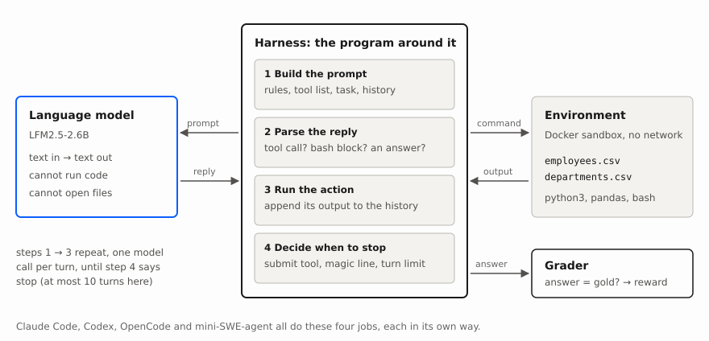
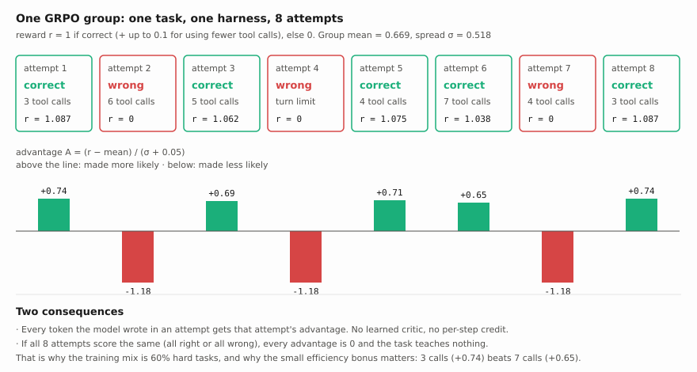
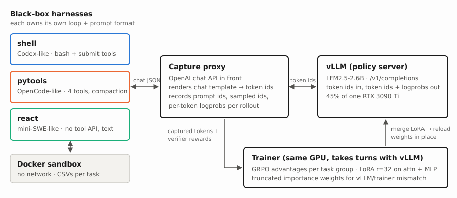
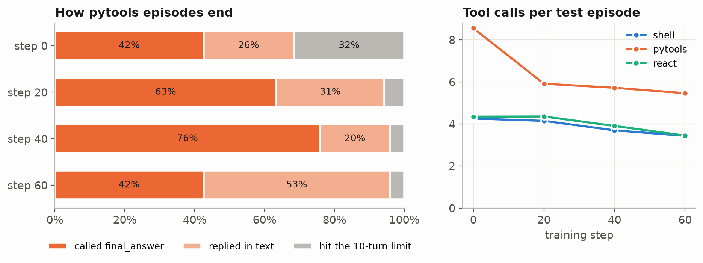
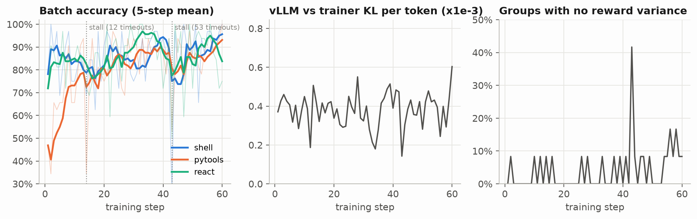

*A from-scratch explanation of harness RL, followed by a small, honest experiment on one consumer GPU.*

**Short version.** I trained a 2.6B-parameter model with reinforcement learning while it worked inside three different agent programs ("harnesses") at once. After 60 training steps (about 5 hours on one RTX 3090 Ti), accuracy on held-out data-analysis tasks went from **66% to 82%**. The biggest gain was on a data domain the model never saw during training. The more interesting findings are about what the training did *not* change, and why.

| | Base model | After 60 RL steps | Change |
|---|---|---|---|
| All three harnesses | 66.1% | **81.9%** | +15.8 points ($p = 3\times10^{-7}$) |
| Question types never trained on | 62% | 75% | +13 |
| Data domain never trained on | 65% | 87% | +22 |

If you already know what a harness is and how GRPO works, skip to [The experiment](#the-experiment).

## Part 1: What is a harness?

### A language model alone can't do anything

A language model does exactly one thing: it reads text and writes more text. It cannot open a file, run a program, or look anything up. When you watch Claude Code edit a repository or Codex run your tests, the model is not doing those things directly. A separate, ordinary program is doing them on the model's behalf.

That program is the **harness**. It sits between the model and the world, and it runs a loop:



1. **Build the prompt.** The harness writes the text the model will read: rules ("you are a coding agent…"), the list of available tools, the task, and everything that has happened so far.
2. **Parse the reply.** The model's reply is just text. The harness has to find the *action* in it: a structured tool call, a code block, or a final answer.
3. **Run the action.** The harness executes the command (here, in a Docker sandbox) and appends the output to the history.
4. **Decide when to stop.** Maybe the model called a `submit` tool. Maybe it wrote a magic line like `FINAL ANSWER:`. Maybe it ran out of turns.

Then it goes back to step 1, until step 4 says stop. One trip around the loop is a **turn**, and the whole thing from task to answer is an **episode** (in RL terms, a **rollout**).

### Every harness does these four jobs differently

Claude Code, Codex, OpenCode, and mini-SWE-agent all run this loop, but they disagree on almost every detail:

- **How actions are written.** Some give the model a tool API, and the model emits structured calls like `shell(command="ls")`. Others have no tool API at all. The model writes a ```` ```bash ```` block in plain text and the harness pulls it out with a regular expression.
- **What the model sees of the past.** Some keep the full history. Others *compact* it: old tool outputs get replaced by a stub to save space, so the model has to remember (or re-read) what it saw.
- **How an episode ends.** A `submit` tool, a `final_answer` tool, a magic string, or simply "a reply with no tool call".

Here is one task as it looks inside the three harnesses used in this experiment:


An analogy: the model is a skilled typist, and the harness is the keyboard layout. The skill transfers, but someone who has only ever typed on one layout will make a lot of mistakes on another, even though they "know" how to type.

### Why this matters for training

When you fine-tune a model to be a better agent, you have to run it inside *some* harness. Whatever you train it in, it learns two things together:

1. **The task skill**: inspect the data, write correct code, check the result.
2. **The harness habits**: this harness ends episodes with `submit`, that one wants `FINAL ANSWER:`, this one hides old outputs.

Train in one harness, deploy in another, and the habits don't match. The [FineEnvs multi-harness RL write-up](https://huggingface.co/spaces/FineEnvs/multi-harness-rl) argues for a simple fix: **train across several harnesses at once**, and treat each one as a black box. Don't modify the harness to make it trainable. Just record exactly what the model saw and what it wrote, and learn from that. That is what I mean by *harness RL*.

## Part 2: How RL works here

### The idea in one paragraph

Give the model a task. Let it try. Check whether the answer is right. Make the things it did on successful attempts more likely, and the things it did on failed attempts less likely. Repeat. Nobody writes example solutions. The only supervision is a checker that knows the right answer. For data questions that's easy: the gold answer is computed with pandas, and the grader compares numbers (with a small tolerance) or strings.

The reward for one episode is:

$$
r \;=\; \mathbb{1}[\text{correct}] \cdot \Big(1 + 0.1 \cdot \mathrm{clip}\big(\tfrac{10 - n_{\text{calls}}}{8},\, 0,\, 1\big)\Big)
$$

That is 1 for a correct answer, plus a bonus of at most 0.1 for using fewer tool calls, and 0 for a wrong answer.

### GRPO: compare attempts with each other

The algorithm is **GRPO** (Group Relative Policy Optimization). Instead of training a second network to predict how good each attempt "should" be, GRPO runs the same task several times and compares the attempts with one another:



Each attempt's **advantage** is how much better it did than the group average, divided by the group's spread: $A_i = (r_i - \bar r)/(\sigma_r + 0.05)$. Every token the model wrote in an attempt gets that attempt's advantage. A positive advantage makes those tokens more likely, and a negative one makes them less likely.

Two consequences follow, and both shape the experiment:

- **A group where every attempt scores the same teaches nothing.** If all 8 are right (too easy) or all 8 are wrong (too hard), every advantage is zero. Useful tasks are the ones the model solves *sometimes*.
- **Small reward differences still count.** Among correct attempts, the efficiency bonus is often the only thing that separates them, so the model is nudged toward shorter episodes.

### LoRA: train a small add-on, not the whole model

Updating all 2.6 billion weights needs far more memory than one 24 GB card has once the inference server is also loaded. **LoRA** freezes the original weights and learns a small low-rank correction next to each weight matrix, $W + \tfrac{\alpha}{r}BA$. Here that is rank 32 on the attention and MLP projections: 40M trainable parameters, 1.5% of the model.

### The capture proxy: what makes a black box trainable

The harnesses in this experiment are ordinary agent loops. Each one is given an OpenAI-compatible URL and nothing else, and none of them knows it is being trained. The trick is what sits behind that URL.



The harness sends chat messages to a **capture proxy**. The proxy converts the messages to **token ids** with the model's chat template and sends those ids to vLLM (the inference server). For every call it records three things: the prompt ids, the ids the model sampled, and the probability of each sampled token. The trainer learns only from these records:


Two details matter here.

1. **Record ids, not text.** A model writes token by token, and the same final text can usually be split into tokens in more than one way. If you rebuild the training data from the chat text afterwards, the tokenizer may pick a different split than the one the model sampled. You would then be training on a sequence the model never produced. Recording the ids at sampling time avoids this.
2. **Harness-agnostic rows.** When a harness only ever appends to its history (shell, react), each new request extends the previous one token for token, and the proxy stitches the whole episode into one training row. pytools rewrites its history (compaction), so each of its calls becomes its own row. The trainer never needs to know which kind of harness it is looking at.

**The full update.** The trainer computes each sampled token's probability under the current weights, $\pi_\theta$, and compares it with the probability vLLM recorded when sampling, $\mu$. In theory these are the same model, but they run on different GPU kernels and disagree slightly. A truncated importance weight corrects for that:

$$
\mathcal{L} \;=\; -\frac{1}{N}\sum_{t} \min\!\Big(\frac{\pi_\theta(y_t)}{\mu(y_t)},\, 2\Big)\, A_t \,\log \pi_\theta(y_t)
$$

Here $N$ is the number of model-written tokens in the batch. Tokens the model only read (prompts, tool outputs) are context, not training targets.

## The experiment

### Setup on one GPU

| Setting | Value |
|---|---|
| Model | LiquidAI LFM2.5-2.6B, the model used in the FineEnvs write-up |
| Hardware | one RTX 3090 Ti (24 GB). vLLM holds 45% of the card; the trainer uses the rest. They take turns |
| Harnesses | shell (like Codex), pytools (like OpenCode / Claude Code), react (like mini-SWE-agent), all at most 10 turns |
| One step | 12 tasks (4 per harness) × 8 attempts each = 96 rollouts |
| Training | 60 steps, LoRA rank 32, AdamW, learning rate $4\times10^{-5}$, sampling temperature 1.0 |
| Evaluation | every 20 steps, 120 fixed test tasks per harness (360 rollouts), temperature 0.7 |
| Wall clock | about 5h20m |

**Getting new weights into vLLM.** After every step vLLM has to serve the updated model. The usual approach is to hot-load the LoRA adapter, but on this machine vLLM's LoRA path for LFM2 decodes about **15× slower**. Instead, the trainer folds the adapter into the base weights and tells vLLM to reload them in place (about 3 seconds for 5 GB), then clears vLLM's prefix cache, since the cached activations came from the old weights.

### The tasks

Each task generates fresh CSV files (retail orders, HR records, or web sessions) and asks one question about them. Column names are randomized between a few variants, so the agent has to look at the files before writing code. Questions come from 46 named templates.

My first version of this experiment trained only in pytools and went from 64% to 100%. That looked great until I checked: 46 of the 50 test questions reused training templates. The model had learned the templates, not the skill. So this version splits the test set three ways:

| Test bucket | What it measures | Example |
|---|---|---|
| **seen** (40 tasks) | training templates on fresh data | “In which year were the most Support employees hired?” |
| **tmpl** (40) | new question types on familiar data (7 held-out retail/HR templates) | “Which month had the largest revenue increase over the previous month?” |
| **domain** (40) | a dataset never seen in training (all 11 web-session templates) | “Which plan has the highest average sessions per user, counting users with zero sessions?” |

Real data is messy, so medium tasks get messy files 50% of the time and hard tasks 90% of the time:

| Mess | What the agent sees |
|---|---|
| `dup` | exact duplicate rows (the question says to count each once) |
| `money` | `"$1,234.50"` strings instead of numbers |
| `case` | `"north"`, `"NORTH "`, `" North"` for the same label |
| `dates` | `2024-03-05`, `03/05/2024`, `Mar 5, 2024` mixed in one column |
| `split` | the main table spread over `orders_part1.csv … orders_part4.csv` |

Gold answers are always computed on the clean data. The training mix is 10% easy, 30% medium, 60% hard, because easy tasks mostly give groups where all 8 attempts succeed, and those carry no signal.

### A harness the model couldn't use

Before training, react scored **0%**, and the reason is worth knowing. react offers no tools, so the model is supposed to write a ```` ```bash ```` block as text. LFM2.5 thinks about this correctly, and then does the other thing anyway:

```text
...The error suggests I should write exactly one ```bash code block as plain text.
Let me first try to read the file with a bash command.</think><|tool_call_start|>[bash(command='head -5 employees.csv')]<|tool_call_end|>
```

It *says* it should write a bash block, then emits its native tool-call syntax. A worked example in the prompt plus an explicit "you have no tool-calling functions" line didn't help (0 of 30). The habit sits below what prompting can reach.

RL can't fix this from zero, because a group of 8 failures has no signal. So react got a fallback parser: a single `bash(command=...)` call written as text is accepted as an action. Everything else stays the same: no tool schema, outputs come back as user messages, and the episode ends with `FINAL ANSWER:`. With the fallback, base react scores 63%. I tracked how often the fallback fires, to see whether RL moves the model toward the intended format:

| Eval step | 0 | 20 | 40 | 60 |
|---|---|---|---|---|
| react actions via the fallback | 85% | 84% | 81% | 79% |

It barely moves. Both formats earn the same reward, so nothing pushes the model toward the intended one. That turns out to be a theme.

## Results

### Accuracy over training


| Harness | Step 0 | 20 | 40 | 60 | Fixed / broken (0 → 60) | $p$ |
|---|---|---|---|---|---|---|
| shell | 85.8% | 82.5% | 86.7% | 87.5% | 13 / 11 | 0.84 |
| pytools | 49.2% | 82.5% | 85.8% | 81.7% | 47 / 8 | $8\times10^{-8}$ |
| react | 63.3% | 67.5% | 82.5% | 76.7% | 30 / 14 | 0.02 |
| **all** | **66.1%** | **77.5%** | **85.0%** | **81.9%** | **90 / 33** | $3\times10^{-7}$ |

*How to read "fixed / broken".* Each test task in each harness is run once at step 0 and once at step 60. "Fixed" means wrong before and right after; "broken" means the reverse. $p$ is a two-sided sign test on those counts. It asks: if training changed nothing, how likely is a split this lopsided?

**pytools gains the most because it started worst.** Before training, 32% of pytools episodes hit the 10-turn limit. The model kept exploring, re-reading files and re-running scripts, and never called `final_answer`. Compaction makes this worse: old outputs become "[earlier output elided]", so the model re-reads what it already saw. RL fixes the cheap part first. Turn-limit failures drop from 32% to 4%, and tool calls per episode fall from 8.6 to 5.5.

**shell doesn't move, because there was little left to fix.** Base shell already solved 98% of medium tasks and 100% of easy ones. Its remaining errors are on hard tasks (77% → 81%). With 120 test tasks, a 2-point change is noise.

**The dip from step 40 to 60 is not a regression.** Overall accuracy goes from 85.0% to 81.9%, but comparing the two steps task by task gives 28 fixed and 39 broken ($p = 0.22$). Evaluation samples at temperature 0.7, so swings of a few points between evals are expected. The fair reading is that the run plateaued after about 40 steps.

### Did it learn the skill or memorize the questions?

| Bucket (all harnesses) | Step 0 | Step 60 | Change |
|---|---|---|---|
| seen templates | 71% | 84% | +13 |
| held-out templates | 62% | 75% | +13 |
| held-out domain (web) | 65% | 87% | **+22** |

Question types the model never trained on improve as much as the ones it did, and the unseen web domain improves the most. That suggests RL mostly taught *process* rather than answers: look at the columns, clean the messy values, stop exploring and answer. The web tasks are mostly single-table lookups, which reward exactly that process. The held-out templates are harder multi-step questions and still sit 9 points below the seen ones.

### Which tasks improved?


| Slice | n | Step 0 | Step 60 |
|---|---|---|---|
| easy / medium / hard | 24 / 126 / 210 | 88 / 77 / 57% | 100 / 92 / 74% |
| clean / 1 mess / 2 messes | 132 / 135 / 93 | 77 / 60 / 59% | 91 / 78 / 75% |
| `case` labels | 63 | 62% | 87% |
| `split` files | 54 | 63% | 83% |
| `dates` mixed formats | 33 | 55% | 76% |
| `money` strings | 90 | 61% | 77% |
| `dup` rows | 81 | 56% | **63%** |

**Mess the model can see gets fixed.** `"$1,234.50"` raises an error. `" NORTH"` shows up in a `value_counts()`. The part files are listed right in the prompt. **Duplicate rows are different.** They raise no error and produce a plausible wrong number, even though the question warns about them. They are the most persistent failure, and a realistic one.

The hardest template is in the held-out domain: "which plan has the highest average sessions per user, counting users with zero sessions" (33% → 50%). It is a denominator trap. The answer needs a left join, and every shortcut gives a confident wrong answer.

### What changed in behavior?



Tool calls per episode dropped in every harness: shell 4.3 → 3.4, react 4.3 → 3.4, pytools 8.6 → 5.5. The efficiency bonus is tiny, but inside a group of 8 attempts it is often the only thing separating two correct ones.

The left panel shows something I didn't expect. Between steps 40 and 60, pytools shifted from ending with the `final_answer` tool (76% → 42%) to **replying in plain text** (20% → 53%). In pytools, a text reply gets one nudge, and a second text reply ends the episode with that text as the answer. The grader scores both endings the same, so the reward can't tell them apart. Ending with plain text is exactly what shell rewards: there, any reply without a tool call ends the episode. So this looks like a **shell habit leaking into pytools**, in a way the reward never sees.

Same lesson as the react fallback: **a harness shapes the model only through what the reward can see.** If you care *how* the model behaves inside a harness, that has to be in the reward.

### Training health



| Metric | Value |
|---|---|
| Rollouts | 60 steps × 96 = 5,760 rollouts, 22M tokens, 8.1M of them model-written (trained) |
| Median step | 105 s of rollouts + 162 s of training + a few seconds of weight sync |
| Peak trainer memory | 11.3 GB (vLLM holds another 45% of the card) |
| vLLM vs trainer KL | $3.8\times10^{-4}$ per token on average, never above $6\times10^{-4}$ |
| Groups with no reward spread | 4% on average |

The KL row is the health check for the weight sync. If vLLM were serving stale or wrong weights, it would jump. It stays flat for the whole run.

The dotted lines mark two **infrastructure stalls**. At step 43, vLLM received no requests for about 10 minutes, and 53 of the 96 rollouts hit the 600-second timeout (step 14 had a smaller one with 12). Those rollouts were scored as wrong answers, which skews that step's update against whatever happened to be running. The run recovered by the next step. The fix is to drop infrastructure failures from the group instead of scoring them zero.

## What I'd take away

1. **Harness RL works at hobby scale.** One 3090 Ti, a 2.6B model, LoRA, and five hours took held-out accuracy from 66% to 82%. The unseen domain moved the most.
2. **Record tokens, not text.** The capture proxy is what makes black-box harnesses trainable, and it is about 250 lines.
3. **Gains go where the model is weakest.** pytools gained 32 points, react 13, shell 2. In a multi-harness run, the average hides which harness is learning.
4. **The reward decides which habits survive.** react kept its non-standard action syntax, and pytools drifted toward shell's way of ending, because neither affected the reward.
5. **Check the test split before celebrating.** My first run's 100% was mostly template memorization.

## Caveats

- **One seed, 120 test tasks per harness.** Differences under about 8 points between single evals are within noise, which is why the main claims use paired sign tests.
- **react is react-with-a-fallback.** Without the fallback parser it scores 0%.
- **Synthetic tasks.** The CSV generator is mine. Real data is messy in ways I didn't think of.
- **Two infrastructure stalls** (steps 14 and 43) contaminated those steps' updates.

## Reproducing

The code is in the `rl_harness` repository next to this post: `proxy.py` (capture proxy), `harnesses.py` (the three harnesses), `tasks.py` (task generator and grader), `sandbox.py` (Docker), and `train.py` (GRPO + LoRA). The run above is:

```bash
# vLLM policy server on :8000, using 45% of the GPU
./serve_vllm.sh
# train (needs the server up); evals at steps 0/20/40/60
.venv-lfm/bin/python train.py --run lfm_multi --harnesses shell,pytools,react \
    --steps 60 --tasks-per-step 12 --group 8 --n-test 40 --eval-every 20
# figures + every number quoted here
.venv-lfm/bin/python analysis/make_blog_figures.py --run lfm_multi --out blog/multi-harness-rl
```

All numbers in this post come from `analysis/results_lfm_multi.json`, which the figure script writes from the run's logs.
